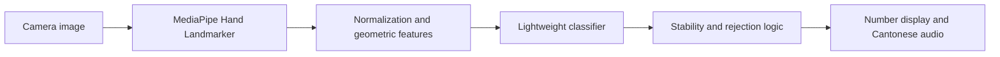

# CSIT5410: Static Number Gesture Recognition

A three-person CSIT5410 Recognition Systems group project: recognize static number gestures from a webcam, display the predicted number, and speak it in Cantonese.

## Project status

**Phase 1 scaffold implemented.** The repository now includes a local browser workbench, shared geometric features, image-to-landmark extraction, participant-separated SVM/MLP training, and browser MLP inference. The initial interface supports one hand only. Real image data and Cantonese recordings are still pending; no real-data recognition results are claimed. See [the phase report](docs/phase-1-report.md).

## MVP scope

- Target numbers **1–10**, with a documented gesture-to-number mapping.
- Prioritize hand shapes used in Chinese-speaking communities; check regional variants before assigning labels.
- Recognize held, static poses. Frame smoothing is allowed; dynamic gesture recognition and continuous sign-language translation are outside the MVP.
- Display a number and play a short Cantonese recording after confirmation or a stable prediction.
- Handle missing hands and uncertain predictions without speaking; prevent repeated playback while a pose is held.

The first version is a number-gesture recognizer, not a validated Hong Kong Sign Language translator. HKSL vocabulary is a possible future extension. Single-hand versus two-hand support will follow the chosen gesture definitions.

## Planned recognition pipeline



MediaPipe provides 21 estimated 3D landmarks per hand: 63 coordinate values. We will implement and evaluate the downstream feature engineering and classification ourselves.

| Component | Planned approach |
| --- | --- |
| Landmarks | Pretrained MediaPipe Hand Landmarker |
| Normalization | Wrist-relative coordinates and palm-scale normalization |
| Geometric features | Finger joint angles, finger spread, normalized fingertip distances, palm normal |
| Baseline | Standardized features with an SVM (implemented offline) |
| Browser classifier | scikit-learn MLP (64, 32), exported as JSON; training data pending |
| Offline processing | Python, NumPy, scikit-learn |
| Browser interface | TypeScript + Vite; browser-side inference where feasible |
| Audio | Prerecorded Cantonese numbers for the MVP |

Preserve meaningful palm orientation when normalizing hand shape. Keep coordinate conventions, left/right-hand handling, feature order, and scaling identical during training and inference. A browser model export must be checked against Python predictions before use.

## Image data plan

Only image datasets are being considered for the initial training pipeline. Extract landmarks from the images and retain the original labels and source identifiers.

| Candidate | What is known | Remaining checks |
| --- | --- | --- |
| [Chinese-number-gestures-recognition](https://github.com/tz28/Chinese-number-gestures-recognition) | Author reports 215 original photographs and 21,592 augmented images; project targets 0–10 | Download availability, actual class coverage, hand shapes, image quality, and permitted reuse |
| [HaGRIDv2](https://github.com/hukenovs/hagrid) | Large RGB hand-gesture dataset with per-class downloads and subject IDs | Select only matching hand shapes, inspect labels and license terms, and avoid downloading the entire dataset unnecessarily |

Other leads remain unverified. No dataset has been selected or downloaded as part of this repository setup. Augmented copies must not be counted as independent captures. Generic gesture labels must not be relabeled as numbers without checking the actual hand shapes.

For each sample, retain where available: source dataset, original image ID, person ID, capture session, gesture variant, numeric label, and landmark extraction status. Record detection failures rather than silently dropping them from evaluation. Supplement missing classes and collect an independent test set if necessary.

## Experiments and evaluation

Compare three feature sets using the same classifier and data split:

1. Normalized landmark coordinates.
2. Engineered geometric features only.
3. Coordinates combined with geometric features.

Report accuracy, macro-F1, per-class confusion, landmark detection failure rate, end-to-end latency, and false or repeated audio triggers. Compare SVM and a small MLP after the feature baseline is established.

Split by person where identifiers exist. Keep every original image and its augmented versions in the same split; augment only after splitting. If subject IDs are unavailable, document that limitation and use separately collected participants to assess generalization. Fit scalers and models on training data only, tune thresholds on validation data, and reserve test data for final evaluation.

## Repository contents

```text
.
├── web/                  # TypeScript browser workbench
├── src/gesture/          # Python features, extraction, training
├── scripts/              # Local asset setup and model parity check
├── tests/                # Geometry, split isolation, state tests
├── data/README.md        # Manifest and JSONL schema
├── models/README.md      # Model artifact conventions
├── docs/                 # Architecture and stage reports
└── paper/                # ISBI paper starter
```

See [paper/README.md](paper/README.md) for the complete paper workflow and template provenance.

## Getting started

Clone using SSH:

```bash
git clone git@github.com:centaurus-xie/csit5410-hand-gesture-recognition.git
cd csit5410-hand-gesture-recognition
```

### Browser workbench

Use a modern Node installation (tested locally with Node 25.9.0):

```bash
npm ci
npm run assets
npm run dev
```

Open `http://127.0.0.1:5173` and allow camera access. The first asset preparation downloads the official MediaPipe detector and copies WASM locally; camera frames are processed locally. Use localhost or HTTPS for camera access. The app has no backend or upload endpoint.

You can inspect landmarks and geometric features without a number classifier. Enter a participant, session, and label to save samples, then export JSONL before closing the page. Sample collection is in memory; no raw image capture is included. Until a model is trained, the interface explicitly reports that no classifier is loaded.

### Python tools

Use Python **3.11 or 3.12** in a project environment. On this machine, a Python 3.12 `.venv` has already been created; activate it with `source .venv/bin/activate`. For a new checkout:

```bash
python3.12 -m venv .venv
source .venv/bin/activate
python -m pip install -e '.[images,dev]'
```

The optional `requirements-macos-py312.txt` records the exact packages used for local validation. It is an environment snapshot, not a cross-platform lockfile.

Prepare an image manifest and participant splits as described in [data/README.md](data/README.md), then run:

```bash
gesture-extract data/manifest.csv --output data/samples.jsonl
gesture-train data/samples.jsonl --splits data/splits.json --classifier svm --features combined --output artifacts/svm
gesture-train data/samples.jsonl --splits data/splits.json --classifier mlp --features combined --output artifacts/mlp
node --import tsx scripts/check-model-parity.mjs artifacts/mlp
```

Repeat experiments with `--features coordinates` and `--features geometry` on the same splits. The SVM is an offline baseline. Load `artifacts/mlp/classifier.json` through the browser's model picker for number recognition. The 0.8 score threshold and 600 ms hold are prototype defaults, not calibrated accuracy guarantees. Unknown gestures can still receive high confidence; evaluate rejection on real negatives before use.

Add licensed/consented Cantonese recordings to `web/public/audio/1.mp3` through `10.mp3`. Missing audio produces a visible error. Audio is not generated or bundled.

### Checks

```bash
npm test
npm run build
python -m pytest -q
```

The production build is written to `web/dist/`. Local datasets, trained models, recordings, virtual environments, and downloaded WASM/model assets are ignored by Git.

To build the existing paper, install a TeX distribution with `latexmk`, then run from the repository root:

```bash
cd paper
mkdir -p .build
latexmk -pdf -interaction=nonstopmode -halt-on-error -outdir=.build main.tex
```

The generated PDF is `paper/.build/main.pdf`. The current paper contains placeholders, not completed experiments.

## Team workflow

| Branch | Purpose |
| --- | --- |
| `main` | Reviewed, shared project state |
| `dev/yr-xie` | Member development |
| `dev/hy-shi` | Member development |
| `dev/qs-li` | Member development |

Work on your own branch and open a pull request into `main`. Configure your own Git identity so commits reflect their authors. Set upstream tracking on the first push with `git push -u origin <branch-name>`. All remote connections use SSH; repository owners perform pushes themselves.

Suggested workstreams, with ownership to be agreed:

- Data: define the gesture vocabulary, verify sources, curate images, and prepare independent splits.
- Recognition: extract landmarks, implement features, train baselines, and evaluate errors.
- Product: implement camera input, display predictions, and add Cantonese playback and trigger control.

## Next milestones

- [ ] Agree on an illustrated 1–10 gesture specification, including regional variants and hand count.
- [ ] Verify and select image data; record source and reuse conditions.
- [x] Add project dependency configuration and a tested local environment (see packaging caveat in phase report).
- [ ] Run landmark extraction and inspect failures by class.
- [x] Implement feature sets and baseline training/export tools.
- [ ] Train and evaluate classifiers on approved real data.
- [ ] Evaluate unseen participants and unknown gestures.
- [ ] Integrate the browser demo and Cantonese audio.
- [ ] Complete the paper, presentation, and references.

## Course deliverables

- Submit a PowerPoint and an **ISBI-format paper of at most 5 pages, including references**, via Canvas.
- Submission deadline: **25 November 2026, 23:59 (Hong Kong time)**.
- Presentation: **26 November 2026**, 15 minutes plus 3 minutes of Q&A.
- Paper: Introduction, Method, Results, and Conclusion.
- Cite pretrained models, methods, and datasets, and document the team's implementation effort.

## References and reuse

- [MediaPipe Hand Landmarker documentation](https://developers.google.com/edge/mediapipe/solutions/vision/hand_landmarker)
- [Course-provided ISBI template](https://github.com/HenryVu27/ISBI2026/tree/main/ISBI_template-master/ISBI_template-master)

The license in `paper/` belongs to the upstream template and does not license the whole project. Dataset and third-party asset terms must be checked separately before redistribution.
