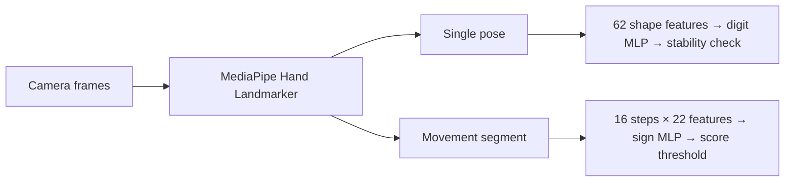

# Single-Hand Gesture Recognition

**English** · [繁體中文](README.zh-TW.md)

A three-person CSIT5410 Recognition Systems project. The browser recognizes static digit poses **0–9** from one hand and uses the same hand tracker to recognize three isolated Hong Kong Sign Language (HKSL) words in motion. It displays the result and can play it in Cantonese, Mandarin, or English.

## Run the demo

The commands below clone the current demo branch over SSH. For an existing checkout of that branch, start with `npm ci` from the repository root.

```bash
git clone --branch dev/yr-xie git@github.com:centaurus-xie/csit5410-hand-gesture-recognition.git
cd csit5410-hand-gesture-recognition
npm ci
npm run assets
npm run dev
```

Open the loopback URL printed by Vite, usually `http://127.0.0.1:5173`. Click **Start camera** and grant camera access. Asset setup downloads the MediaPipe model and copies its WebAssembly files. The branch includes the digit and sign classifiers. The browser displays recognition results before you set up Python or voice packs.

To enable speech, generate the offline packs on macOS with the installed **Sinji**, **Tingting**, and **Samantha** system voices. The command uses Python 3 and writes WAV files to `web/public/audio/{yue,zh,en}/`. On other systems, copy those folders from a Mac that generated them. [Voice pack instructions](web/public/audio/README.md)

```bash
npm run audio:generate
```

The updated generator in the working copy creates recordings for individual sign words as well as digits and the demo sentence. With an earlier generator, copy the complete WAV packs to enable individual word playback.

## Use the workbench

| Control | Behaviour |
| --- | --- |
| **Recognition → Numbers** | Hold a digit pose. When the same known digit scores at least 0.80 for 600 ms, the app confirms it. Automatic speech plays once per held pose when enabled. |
| **Recognition → Sign words** | Make **多謝**, **下次**, or **再見**, one word at a time, then pause. The app detects the movement boundaries, classifies the clip, and shows the word. **Clip and model options** also accepts a local video or a manually bounded clip. |
| **Recognition → Instruments** | Choose piano, guitar, or flute. Digits 1–9 play notes after a 120 ms hold. Digit 0 fades the current note. **Chord accompaniment** adds a triad. The keys can preview sounds without a camera. |
| **Data entry** | Save a manually labelled pose or review a stable prediction before saving it. Set the participant, session, and split in **Session settings**. |

**Voice language** applies to number and word playback. In sign mode, the accepted sequence **多謝 → 下次 → 再見** enables **Speak sentence** when the phrase recording is available. The sign vocabulary is limited to three isolated words. [HKSL recording references and clip format](docs/isolated-signs.md#classroom-vocabulary)

## Recognition pipeline



MediaPipe estimates 21 hand landmarks. The browser runs it in VIDEO mode on the CPU with detection, presence, and tracking thresholds of **0.60, 0.60, and 0.50**. It can detect up to two hands so the recognizer can accept observations with exactly one hand.

- **Static digits.** Each frame becomes a 62-value `shape` vector containing 10 finger bend angles, 3 finger spread angles, 4 thumb-to-fingertip distances, and 45 pairwise distances among 10 anchors. The MLP has 64 and 32 hidden units and scores 0–9 plus `unknown`.
- **Isolated signs.** The app detects movement from changes in hand geometry or wrist position. Each time step contains 20 geometric values, including palm orientation, and two wrist offsets from the start of the clip. Resampling to 16 steps gives the sign MLP **352 input values**. It confirms a word at a score of at least **0.80**.

The TypeScript/Vite app runs inference and audio playback in the browser. Python, NumPy, and scikit-learn handle offline extraction, feature engineering, and training. [Browser features](web/src/features.ts) · [Sign segmentation](web/src/signs.ts) · [Python training](src/gesture/)

## Evaluation snapshot

| Run | Result |
| --- | --- |
| Previous digit model `bd58a350`, tracker group D | 22 of 23 clips had a correct first stable output |
| Current digit model `8987cc5b`, tracker group D | 23 of 23 clips had a correct first stable output. 22 of 23 passed the separate strict frame-majority criterion |
| Current sign model | Fit on 81 usable clips across the three words. Held-out signer accuracy has yet to be measured |

The digit figures come from the same 23 development videos used for model selection. The first-stable metric scores the first digit that satisfies the confirmation rule in each clip. The frame-majority metric requires strictly more than half of the sampled frames in each clip to have the correct top prediction. The working copy contains the slide deck and experiment figures under `presentation/`. [Default digit model metadata](web/public/models/default-info.json) · [Course paper and reporting protocol](paper/README.md)

## Collect samples and retrain

Set up Python 3.11 or 3.12 for local project saves, training, and Python tests. The commands below use Python 3.12.

```bash
python3.12 -m venv .venv
source .venv/bin/activate
python -m pip install -e '.[images,dev]'
```

1. Run the app on localhost with `npm run dev`. In **Data entry → Session settings**, set the participant, session, and dataset split. Keep a participant in the same split across sessions.
2. Select a label and click **Save sample** to capture the current pose. For automatic collection, enable **Record stable digits**, inspect the captured hand thumbnail, adjust the label if needed, and click **Confirm label**.
3. Check the project save status below the camera controls. Confirmed landmarks are written to the local SQLite database at `data/local-captures/digits.sqlite3`. Use **Correct a confirmed label** to revise a saved label and **Retry project save** to retry pending writes. Camera frames and review thumbnails stay in the browser. The project writer runs on localhost, and the database stays local.

For a new checkout, create the base digit image artifacts with the first command below. It uses the MediaPipe files from `npm run assets`. Once you have at least one confirmed **Training** sample, the second command trains both the combined and shape candidates using the existing image split plus local training samples. Run the third command to check Python/browser parity for the shape candidate.

```bash
.venv/bin/python scripts/train_pilot.py --expanded
npm run train:digits:local
node --import tsx scripts/check-model-parity.mjs artifacts/digits-reviewed/mlp-shape
```

Open **Digit model settings → Choose another model…** to try the exported `classifier.json` in the current page. To promote a reviewed shape candidate to the default, run the command below. Refresh the page or click **Use latest default model**, then check **Active digit model**.

```bash
npm run model:publish -- artifacts/digits-reviewed/mlp-shape/classifier.json
```

Training outputs are local under `artifacts/`. For sources and gesture variants, see the [data format and variant guide](data/README.md#preparing-new-gesture-variants) and [paper bibliography](paper/references.bib). For a new sign model, follow the [clip extraction and training commands](docs/isolated-signs.md#run-the-local-pipeline).

## Checks and course deliverables

```bash
npm test
npm run build
.venv/bin/python -m pytest -q
```

The production build is written to `web/dist/`. Use your team branch and open a pull request into `main`. SSH branches for the three contributors are `dev/yr-xie`, `dev/hy-shi`, and `dev/qs-li`.

Submit the PowerPoint and the ISBI-format paper via Canvas by **25 November 2026 at 23:59 Hong Kong time**. The paper limit is **five pages including references**. The **26 November** presentation is **15 minutes plus 3 minutes of Q&A**. [Paper build and submission instructions](paper/README.md)
