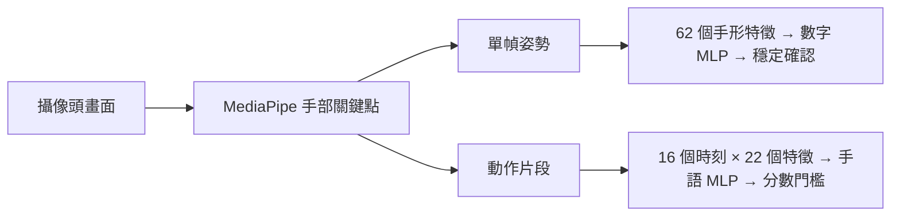

# 單手手勢辨識系統

[English](README.md) · **繁體中文**

這是 CSIT5410 Recognition Systems 的三人小組專案。系統在瀏覽器辨識單手比出的 **0–9 靜態數字**，並用同一套手部追蹤辨識三個動態的香港手語孤立詞。畫面會顯示結果，也可選擇以粵語、普通話或英語播報。

## 啟動示範

以下指令透過 SSH 複製目前的示範分支。若本機已切到該分支，在專案根目錄從 `npm ci` 開始即可。

```bash
git clone --branch dev/yr-xie git@github.com:centaurus-xie/csit5410-hand-gesture-recognition.git
cd csit5410-hand-gesture-recognition
npm ci
npm run assets
npm run dev
```

開啟 Vite 印出的本機網址，通常是 `http://127.0.0.1:5173`。點 **Start camera** 並允許攝像頭存取。資源準備指令會下載 MediaPipe 模型，並複製其 WebAssembly 檔案。分支已包含數字和手語分類器，瀏覽器在設定 Python 和語音包前即可顯示辨識結果。

如需播報，在 macOS 安裝 **Sinji**、**Tingting** 和 **Samantha** 系統語音，再用以下指令產生離線語音包。指令使用 Python 3，並將 WAV 寫入 `web/public/audio/{yue,zh,en}/`。其他作業系統可直接使用從 Mac 複製過來的語音資料夾。[語音包說明](web/public/audio/README.md)

```bash
npm run audio:generate
```

工作副本中的新版腳本可產生數字、單個手語詞和示範句的錄音。若使用較早的腳本，可複製完整的 WAV 語音包來啟用單詞播報。

## 使用介面

| 操作 | 功能 |
| --- | --- |
| **Recognition → Numbers** | 保持數字手勢。當同一個數字的分數持續達到 0.80，經過 600 毫秒後確認。啟用自動播報時，持續比同一姿勢只播一次。 |
| **Recognition → Sign words** | 每次做一個詞，完成後稍停。支援 **多謝**、**下次**、**再見**。系統自動找出動作起止並顯示分類結果。**Clip and model options** 也可開啟本機影片，或手動指定攝像頭片段的起止。 |
| **Recognition → Instruments** | 選擇鋼琴、結他或長笛。維持 1–9 的手勢 120 毫秒可觸發音符，0 讓目前音符淡出。**Chord accompaniment** 可加三和弦。畫面上的琴鍵可直接試聽。 |
| **Data entry** | 手動標註姿勢，或覆核穩定辨識結果再儲存。在 **Session settings** 設定參與者、錄製場次和資料劃分。 |

**Voice language** 同時設定數字和手語詞的播報語言。依次辨識出 **多謝 → 下次 → 再見** 後，如已備妥片語音檔，可用 **Speak sentence** 播放預錄句子。目前手語範圍為三個孤立詞。[香港手語拍攝參考和影片格式](docs/isolated-signs.md#classroom-vocabulary)

## 辨識流程



MediaPipe 估計 21 個手部關鍵點。瀏覽器以 CPU 執行 VIDEO 模式，偵測、手部存在和追蹤門檻依次為 **0.60、0.60、0.50**。追蹤器最多可偵測兩隻手，辨識流程只接收恰好偵測到一隻手的觀測。

- **靜態數字。** 每幀轉成 62 維 `shape` 向量，包含 10 個手指彎曲角、3 個指間張開角、4 個拇指尖距離和 10 個錨點之間的 45 個成對距離。MLP 的兩個隱藏層分別有 64 和 32 個單元，輸出 0–9 與 `unknown` 的分數。
- **孤立手語詞。** 系統從手部幾何或手腕位置的變化找出動作。每個時刻記錄 20 個幾何量，包括掌面朝向，以及兩個相對片段起點的手腕位移量。重採樣為 16 個時刻後，手語 MLP 接收 **352 個數值**，以 **0.80** 為詞語確認門檻。

前端使用 TypeScript 和 Vite，在瀏覽器執行推論與播報。離線關鍵點提取、特徵工程及訓練使用 Python、NumPy 和 scikit-learn。[瀏覽器特徵提取](web/src/features.ts) · [手語片段切分](web/src/signs.ts) · [Python 訓練程式](src/gesture/)

## 評估結果

| 模型與條件 | 結果 |
| --- | --- |
| 舊版數字模型 `bd58a350`，追蹤 D 組 | 23 段中有 22 段的首次穩定輸出正確 |
| 目前預設數字模型 `8987cc5b`，追蹤 D 組 | 23 段的首次穩定輸出均正確。按逐幀嚴格過半的標準，23 段中有 22 段通過 |
| 目前手語模型 | 用三個詞合共 81 段可用影片擬合。尚未量度獨立簽者的辨識準確率 |

數字結果來自同一批用於選型的 23 段開發影片。首次穩定輸出以每段中第一個達到確認條件的數字計分。逐幀嚴格過半則要求每段影片超過一半的採樣幀預測正確。工作副本的簡報與圖表放在 `presentation/`。[預設數字模型資訊](web/public/models/default-info.json) · [課程論文及評估報告格式](paper/README.md)

## 採集樣本與重新訓練

本機寫入、訓練和 Python 測試使用 Python 3.11 或 3.12。以下以 Python 3.12 為例。

```bash
python3.12 -m venv .venv
source .venv/bin/activate
python -m pip install -e '.[images,dev]'
```

1. 以 `npm run dev` 啟動並使用本機網址。在 **Data entry → Session settings** 設定參與者、錄製場次與資料劃分。同一參與者在不同場次應沿用相同劃分。
2. 選擇標籤後點 **Save sample**，採集當前姿勢。也可啟用 **Record stable digits** 自動擷取穩定結果，檢查手部縮圖、按需要修正標籤，再點 **Confirm label**。
3. 在攝像頭控制列下方查看儲存狀態。已確認的關鍵點會存入本機 SQLite 資料庫 `data/local-captures/digits.sqlite3`。用 **Correct a confirmed label** 修改已確認的標籤，或用 **Retry project save** 重試待寫入的資料。攝像頭畫面和覆核縮圖留在瀏覽器，樣本寫入服務及資料庫均在本機。

新 checkout 先執行第一條指令建立基礎數字影像資料。這一步會用到 `npm run assets` 準備的 MediaPipe 檔案。至少有一筆已確認的 **Training** 樣本後，第二條指令會使用原有影像劃分和本機訓練樣本，一併訓練 combined 和 shape 候選模型。第三條指令檢查 shape 候選在 Python 與瀏覽器的預測是否一致。

```bash
.venv/bin/python scripts/train_pilot.py --expanded
npm run train:digits:local
node --import tsx scripts/check-model-parity.mjs artifacts/digits-reviewed/mlp-shape
```

在 **Digit model settings → Choose another model…** 選擇匯出的 `classifier.json`，即可在目前頁面試用。要將驗證過的 shape 候選設為預設模型，執行下列指令。重新整理網頁或點 **Use latest default model**，再在 **Active digit model** 確認版本。

```bash
npm run model:publish -- artifacts/digits-reviewed/mlp-shape/classifier.json
```

訓練產物存放在本機的 `artifacts/`。資料來源與手勢變體可參閱[資料格式與變體操作](data/README.md#preparing-new-gesture-variants)和[論文參考文獻](paper/references.bib)。重訓手語模型可參閱[影片提取與訓練指令](docs/isolated-signs.md#run-the-local-pipeline)。

## 檢查與課程交付

```bash
npm test
npm run build
.venv/bin/python -m pytest -q
```

正式建置輸出到 `web/dist/`。三位成員各自在 `dev/yr-xie`、`dev/hy-shi` 或 `dev/qs-li` 工作，再向 `main` 開啟 pull request。

PowerPoint 和 ISBI 格式論文經 Canvas 提交，截止為 **2026 年 11 月 25 日 23:59（香港時間）**。論文**連同參考文獻最多五頁**。**11 月 26 日**匯報為 **15 分鐘加 3 分鐘問答**。[論文建置與提交說明](paper/README.md)
